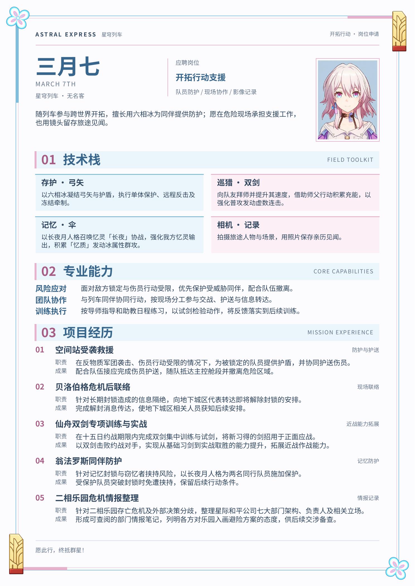
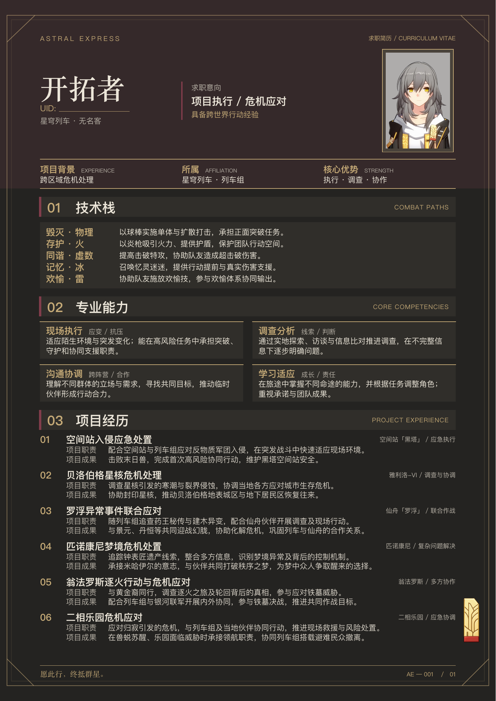

# 星穹列车角色简历

收录《崩坏：星穹铁道》三月七与开拓者的同人求职简历，包含 PDF、预览图、可编辑 Typst 源码和素材。

制作新角色或继续修改时，可使用[简历制作提示词与检查清单](PROMPT.md)，其中汇总了本项目的内容改写、排版、素材保真与交付要求。

## 查看与下载

| 角色 | PDF | 预览 | 编辑说明 |
| --- | --- | --- | --- |
| 三月七 | [下载简历](march7/output/pdf/march7-resume.pdf) | [预览图](march7/output/pdf/march7-resume-preview.png) | [项目说明](march7/README.md) |
| 开拓者 | [下载简历](trailblazer/stelle-cv.pdf) | [预览图](trailblazer/preview.png) | [项目说明](trailblazer/README.md) |

### 三月七



### 开拓者



## 编辑与构建

三月七：修改 `march7/config/character.json` 中的内容，以及 `march7/config/theme.typ` 中的主题配置。详细依赖、字体和校验方式见角色目录内的 README。

```sh
cd march7
python3 -m venv .venv
source .venv/bin/activate
python -m pip install -r requirements.txt
python scripts/build.py
```

开拓者：修改 `trailblazer/main.typ` 中的内容，以及 `trailblazer/template.typ` 中的版式。使用 Typst CLI 编译；字体要求见角色目录内的 README。

```sh
cd trailblazer
typst compile main.typ stelle-cv.pdf
```

## 素材与说明

本仓库为非官方同人创作，简历含游戏剧情内容。角色与游戏素材版权归原权利人所有，素材来源及创作记录保留在各角色目录中。三月七项目随附的 Noto Sans SC 字体按其 SIL OFL 许可证分发。
