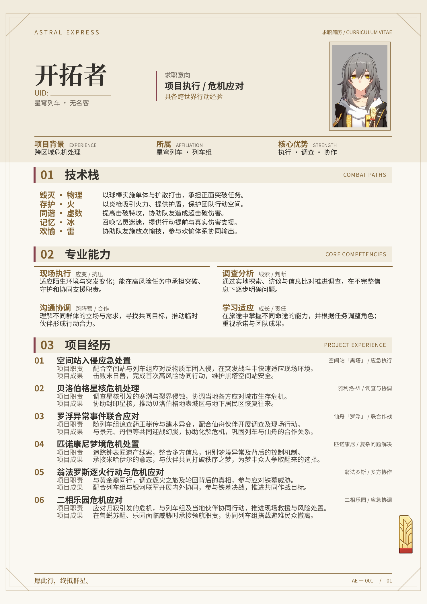

# 星穹列车 · 开拓者求职简历（浅色版）

暖白、浅米色、炭灰与酒红金色的单页 Typst 模板。以 [深色版](../trailblazer/README.md) 为基础，仅调整页面、文字、色块及边框配色；全部文案、字号、间距、坐标、照片与边缘车票保持一致。

[查看 PDF](stelle-cv.pdf) · [预览图](preview.png) · [600 dpi 高清图](stelle-cv-600dpi.png)



名称为开拓者，UID 位于名称下方，证件照采用用户提供的图片，按原始 2:3 比例展示。

内容以游戏主线为基础改写为求职主题：求职意向、项目职责、项目成果及专业能力。属非官方同人二创，含空间站至二相乐园的主线剧情节选；不代表现实任职经历。

## 编辑
- `config/profile.json`：修改姓名、UID、身份、求职意向、摘要、技术栈、能力、项目和结语；深浅两版使用相同结构，默认内容保持原样。
- `main.typ`：读取 JSON 并组织各个区块，无需逐段修改 Typst 文案。
- `template.typ`：配色、字体、组件布局。
- `assets/stelle-id.png`：当前证件照；可在 JSON 的 `portrait` 中换为本目录内的图片相对路径，保持原比例显示。
- `assets/frame.svg`：原创边框；车票沿用 `assets/express-ticket-redrawn.png`。

资料结构：`name`、`uid`、`identity`、`job_title`、`job_note`、`portrait`、`closing` 为字符串；`facts` 为 `{title, en, body}` 数组，`paths` 为 `{title, body}` 数组，`skills` 为 `{title, subtitle, body}` 数组，`projects` 为 `{title, tag, duty, outcome}` 数组。`sections` 包含 `paths`、`skills`、`projects` 三组 `{title, en}` 章节标题。JSON 文本按普通文字显示，不执行 Typst 标记。

姓名不能为空且最多 10 个字符；UID 留空时保留填写横线。任一内容数组设为 `[]`，会隐藏该区块及其章节标题；章节与项目按显示顺序自动编号。摘要每行最多三列，专业能力每行两列。长内容按原字号自然分页，不会静默缩小字体；导出前应检查页数、标题与照片是否被挤压，精简内容至一页 A4。

正文统一使用 `Noto Sans SC`，姓名与页脚结语使用 `Noto Serif CJK SC`。字体复用仓库中的 `../trailblazer-social-strip/assets/fonts/`，不依赖本机字体。从本目录编译：

```sh
typst compile --ignore-system-fonts --font-path ../trailblazer-social-strip/assets/fonts main.typ stelle-cv.pdf
# 使用另一份配置；路径相对于本目录：
typst compile --ignore-system-fonts --font-path ../trailblazer-social-strip/assets/fonts --input profile=config/your-profile.json main.typ your-profile.pdf
```

上传 Typst 网页端时，携带两个 `.typ` 文件、`config/`、`assets/`，并从上述字体目录一同上传 `NotoSansSC.ttf` 和 `NotoSerifCJKsc-Bold.otf`。修改内容或字体后重新编译并检查分页。

## 配色

| 用途 | 色值 |
| --- | --- |
| 暖白纸面 | `#FAF8F2` |
| 页首底色 | `#F1EBDD` |
| 章节标题带 | `#F0EBDD` |
| 正文与标题 | `#34312D` |
| 金色文字与细线 | `#806132` |
| 次要文字 | `#6A6258` |
| 酒红强调线 | `#87434E` |
| 项目正文 | `#4B4640` |
| 照片外衬 | `#E8E0D0` |
| 边框 | `#AD946C` |

车票和照片直接使用深色版原文件，不做滤镜、换色或重绘。`assets/frame.svg` 仅替换颜色，保留全部路径、尺寸和透明度。

## 排版与预览

沿用深色版已确认的排版，采用适合浅色纸面的深色文字与金色强调。`template.typ` 的 `sizes` 集中控制章节标题与编号（16pt）、项目标题（11.5pt）、技术与能力条目标题（11pt）、正文（9.2pt）及辅助标签（7.5pt）；保持章节标题大于内部标题、内部标题大于对应正文。`spacing` 控制章节前后与项目之间的留白。

页首分为姓名与 UID、求职意向、原比例证件照三组；三个摘要单元的中文标题为 10.5pt。技术栈保留五行，专业能力采用两列四项，项目经历的职责与成果使用固定标签列对齐。三个章节仅标题带使用浅米色，内容区均不填充底色，统一呈现暖白纸面。正文按自然排版流排列，长内容自然分页；页脚结语与页码并列，为边框留出空间。角色文案、照片与车票素材保持原样。

重新编译后，用 Poppler 从 PDF 导出预览与 600 dpi 高清图：

```sh
pdftoppm -r 180 -png -singlefile stelle-cv.pdf preview
pdftoppm -r 600 -png -singlefile stelle-cv.pdf stelle-cv-600dpi
```

每次修改后核对单页 A4、全部六个项目的文字完整性，以及标题、卡片、页脚和右下车票有无重叠。

历史图片保留在 assets 中但未使用：stelle.png 来源为 Mar-7th/StarRailRes，stelle-front.jpg 来源为 The Nerd Stash 的游戏截图。角色素材版权归原权利人。

新增经历参考：
- 翁法罗斯：https://www.hoyoverse.com/en-us/news/160640
- 二相乐园：发行方 4.1 新闻稿回顾的 4.0 阶段成果，https://prtimes.jp/main/html/rd/p/000000396.000096124.html
二相乐园条目只描述参赛前期的阶段成果，不宣称整段故事已完成。

车票装饰：assets/express-ticket-redrawn.png，通过内置 imagegen 按用户证件照胸前车票重绘，非游戏原始导出素材。提示词：提取胸前细长金色车票，保留分叉轨道纹样与红色底边，正面端正、透明背景、高清赛璐璐风格，不添加文字。

专业能力同时保留五种已实装命途（毁灭·物理、存护·火、同谐·虚数、记忆·冰、欢愉·雷）与四项通用职业能力。欢愉实装依据：https://sr.mihoyo.com/news/163630?lang=en-us&nav=news&type=news

## 第 06 项更新（2026-10-12）
更新至 4.6 千星城主线，替换此前仅至击败火花的早期经历。将已发生的撤离与调查写为阶段成果，不把钓猎行动写成已经彻底解决贪饕。
参考：
- 官方版本与章节：https://hsr.hoyoverse.com/zh-cn/news/166468
- 撤离与领航职责：https://wiki.biligame.com/sr/挥掷千星的筹码
- 生研院调查：https://wiki.biligame.com/sr/知识、沉默、擦肩而过
- 钓猎行动：https://wiki.biligame.com/sr/命路歧图/月升之前，与兽共舞
