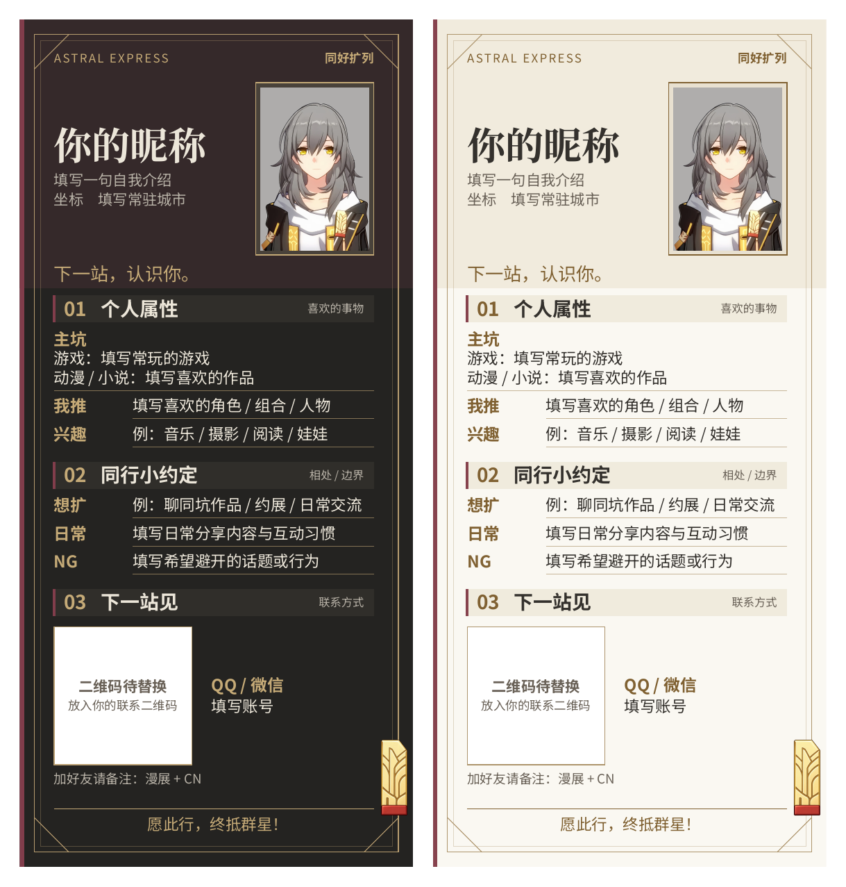
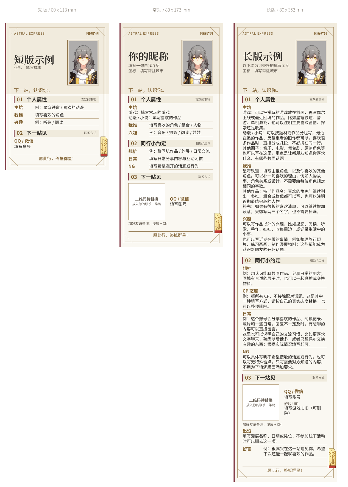

# 开拓者 · 漫展扩列条模板

沿用开拓者简历的金色、酒红、双线斜角边框与列车票装饰，提供深色和浅色两版。**宽度固定为 80 mm，高度随内容自动伸缩**。正文固定为 9 pt，字段标题 9.5 pt，章节标题 11.2 pt；长内容通过换行、分段和延长条幅容纳。所有正文区不填底色，仅章节标题带分区。

## 成品



| 配色 | 单张 PDF | 预览 | 高清 PNG |
| --- | --- | --- | --- |
| 深色 | [下载](output/pdf/trailblazer-strip-dark.pdf) | [查看](output/images/trailblazer-strip-dark-preview.png) | [600 dpi](output/images/trailblazer-strip-dark-600dpi.png) |
| 浅色 | [下载](output/pdf/trailblazer-strip-light.pdf) | [查看](output/images/trailblazer-strip-light-preview.png) | [600 dpi](output/images/trailblazer-strip-light-600dpi.png) |

默认资料另有 [A4 裁切拼版](output/pdf/trailblazer-strip-a4-print.pdf)：两页分别为深色与浅色，每页两张，带裁切标记。按 **100% / 实际大小** 打印，不选“适合页面”。实际尺寸记录在 [manifest.json](output/manifest.json) 中。

## 长短内容如何适配



- **短版**：[config/examples/short.json](config/examples/short.json)，只填写喜欢的作品、角色、其他兴趣和联系方式。
- **常规版**：[config/profile.json](config/profile.json)，带分组喜好、日常与互动说明、二维码占位。
- **长版**：[config/examples/long.json](config/examples/long.json)，展示多段作品与角色介绍、其他兴趣和较长的相处说明。全部文字都是填写示例。

三种长度使用同一份排版，不需要手动选择尺寸。单行内容保持左右排版；多段、含换行或较长的内容改为标题在上、正文在下，并使用完整正文宽度。空字段、空段落和整组空内容自动隐藏，章节编号自动连续。边框、底部斜角和车票随页面高度调整。

长条 PDF 和 PNG 保持完整内容。**高度超过 267 mm 时，不生成 A4 拼版**，构建会提示并移除该输出目录旧的 A4 文件，避免误印。可用长图在线分享，或将单张 PDF 按实际尺寸交给支持长条纸张的打印服务。单张 PDF 是净尺寸、无出血；专业印刷所需出血按印厂要求另行处理。

## 填写资料

编辑 `config/profile.json`，一次构建同时更新两种配色。“个人属性”指喜欢的作品、人物和其他事物；模板不设置“同担接受情况”一栏。

| 字段 | 用途 |
| --- | --- |
| `nickname` | 昵称 / CN，必填，最多 24 个字符；长昵称可换行 |
| `intro`、`location` | 页首一句自我介绍、常驻城市，均可省略 |
| `tagline` | 页首邀请短句 |
| `fandoms` | 主坑：喜欢的游戏、动漫、小说、电影或圈子 |
| `favorites` | 我推：喜欢的角色、组合、人物，可按作品分组 |
| `interests` | 兴趣：音乐、阅读、摄影、手作、娃娃等其他喜欢的事物 |
| `looking_for` | 想扩：想认识什么样的朋友、想一起做什么 |
| `cp` | 可选的 CP 态度：具体嗑的 CP、不嗑、拒所有 CP；留空则整行隐藏 |
| `preferences` | 日常：空间 / 朋友圈会分享什么、回复与互动习惯 |
| `boundaries` | NG：希望避开的话题或行为，按需填写 |
| `contact_platform`、`contact` | 联系平台与账号，均可省略 |
| `uid` | 可选的游戏 UID；不填时隐藏 |
| `contact_note` | 添加好友时的备注要求 |
| `event`、`message` | 可选的漫展 / 日期 / 摊位、留言 |
| `closing` | 页脚短句 |
| `portrait` | 头像的项目内相对路径；省略时使用开拓者头像 |
| `show_qr` | 是否展示二维码区，默认 `true`；只留账号时可设为 `false` |
| `qr_image` | 二维码图片路径；省略或为 `null` 时展示明确的待替换框 |

除昵称外，文本字段可以省略或设为 `""`。主坑、我推、兴趣、想扩、CP 态度、日常、NG、出没和留言还支持字符串数组，每项是一段。以下两种写法都可以：

```json
"fandoms": "星穹铁道 / 喜欢的动漫 / 最近在读的小说"
```

```json
"fandoms": [
  "游戏：填写常玩的游戏，也可以补充最近回坑的作品。",
  "动漫 / 小说：填写喜欢的作品，可以继续添加段落。",
  "其他圈子：填写音乐、电影、原创角色等。"
]
```

字符串中也可以用 `\n` 手动换行。想删除一个条目，可删掉整个键，或使用 `""`、`[]`。不会为已删除的条目保留空行。

“CP 态度”不要求一定有喜欢的配对。想明确不接触任何 CP 内容时，可以填“拒所有 CP”；“不嗑 CP”与拒绝接触所有 CP 并不等同。默认模板将该项留空，长版仅展示一种可替换的例子，不预设使用者的立场。

模板中的“填写……”及以“例：”开头的文字均是占位或填写示例。没有复制参考扩列条中的个人姓名、经历、账号、照片或二维码。填写完成后请删除“填写”“例”等提示词。

### 联系二维码

二维码区域是明确标注的待替换框，不是可扫描的假码。将完整二维码放入 `assets/`，然后设置：

```json
"show_qr": true,
"qr_image": "assets/contact-qr.png"
```

二维码展示区为 28 × 28 mm 白底框，图像在其中以 24 × 24 mm 等比显示，并保留额外白边。请使用保留完整静区的二维码，打印后实际扫码确认。公开模板保留占位；个人填写版可在本地导出，无需把真实账号和二维码提交到公开仓库。

## 构建

需要 Python 3.9+、Poppler（提供 `pdftoppm`）。首次安装依赖需联网，字体和素材均随项目保存，后续编译无需远程 Typst 包。

```sh
cd trailblazer-social-strip
python3 -m venv .venv
source .venv/bin/activate
python -m pip install -r requirements.txt
python scripts/build.py
```

Windows 激活命令为 `.venv\Scripts\activate`；macOS 可通过 `brew install poppler` 安装 Poppler。构建脚本从自身位置解析项目目录，不依赖当前工作目录。

导出不同长度时，为每份资料选择自己的输出目录，避免覆盖默认成品：

```sh
python scripts/build.py --profile config/examples/short.json --output-dir output/short
python scripts/build.py --profile config/examples/long.json --output-dir output/long
```

每次构建都会生成两版 PDF、180 dpi 预览、600 dpi 图片、配色对照图和 `manifest.json`。可放入 A4 时另生成拼版。发布输出前会检查单页、80 mm 宽以及全部非空资料文字是否完整。

也可以用 Typst CLI 单独编译，页面高度同样自动适配：

```sh
typst compile --root . --font-path assets/fonts --ignore-system-fonts --input theme=dark main.typ output/pdf/trailblazer-strip-dark.pdf
typst compile --root . --font-path assets/fonts --ignore-system-fonts --input theme=light main.typ output/pdf/trailblazer-strip-light.pdf
```

在线编辑时上传整个目录并保留层级，入口为 `main.typ`，无输入时默认深色。颜色位于 `config/themes.typ`，排版位于 `components/strip.typ`。

## 内容与素材

- 内容结构采用“简短自介、喜欢的事物、相处说明、联系方式”。参考公开扩列自介及提供的长短例图中的内容分类，保留本项目原有排版风格。
- 公开内容参考：[QooApp 扩列自介](https://notes.qoo-app.com/note/3531703)、[微博属性表](https://www.weibo.com/6758518172/Po80ayv20)、[扩列自介模板](https://ivanamamiya.github.io/self-intro-template/)。只参考字段与分组方式。
- 肖像和透明车票直接复制自已确认的开拓者简历，图片像素未改变；车票是参考角色胸前装饰重绘的素材，来源说明见[开拓者简历](../trailblazer/README.md)。
- 保留暖炭灰 / 暖白、金色、酒红两套配色，以及双线、斜角和边缘车票。
- “下一站，认识你”“同行小约定”“下一站见”为模板文案，不标注为游戏角色原台词。
- 随包使用 Noto Sans SC 和 Noto Serif CJK SC Bold，保留 `assets/fonts/` 中的 SIL OFL 许可。
- 本项目为非官方同人模板，角色与游戏素材版权归原权利人所有。
